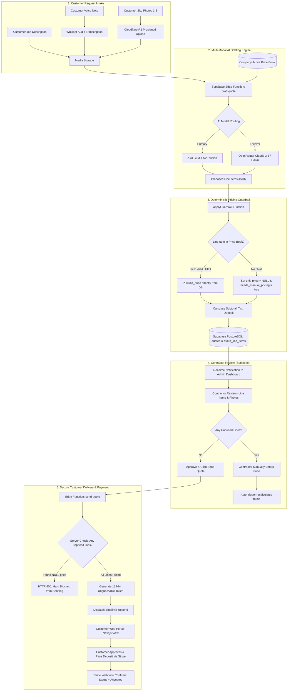
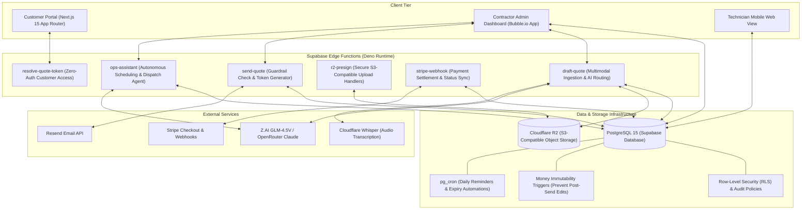

# FieldQuote: AI-Driven Field Service Quoting & Operations with Deterministic Pricing Guardrails

[](https://nextjs.org/)
[](https://supabase.com/)
[](https://www.cloudflare.com/products/r2/)
[](https://stripe.com/)
[](https://resend.com/)

FieldQuote is an end-to-end commercial operations and AI quoting platform designed for trade contractors (Electricians, HVAC, Plumbing). It automates customer intake, multimodally analyzes voice dictation and job site photos, drafts line-item proposals using LLMs, and enforces **strict deterministic pricing guardrails** so the AI cannot hallucinate or invent customer prices.

---

## 1. End-to-End System Workflow

The following flowchart illustrates how a customer request progresses from intake to AI drafting, guardrail validation, technician dispatch, and customer payment.



---

## 2. The Critical Pricing Guardrail (Anti-Hallucination)

Most generative AI applications suffer from the **hallucination liability problem**: if an LLM generates a quote, it can easily invent arbitrary rates, causing contractors to lose thousands of dollars on misquoted labor.

FieldQuote implements **The Golden Guardrail Rule**: **The LLM is strictly forbidden from setting prices.**

```mermaid
flowchart TD
    A[AI Proposes Work Line Items] --> B[Read Line: price_book_item_id]
    B --> C{Does ID exist in company price_book_items?}
    
    C -->|MATCH FOUND| D[Discard any price model suggested]
    D --> E[Assign unit_price = db_row.unit_price]
    E --> F[Set unit_price_source = price_book]
    
    C -->|UNMATCHED / NULL| G[Set price_book_item_id = NULL]
    G --> H[Set unit_price = NULL]
    H --> I[Set unit_price_source = needs_manual_pricing]
    I --> J[Mark quotes.needs_manual_pricing = true]
    
    F --> K[(Insert quote_line_items)]
    J --> K
    
    K --> L[Contractor Triggers send-quote]
    L --> M{Server Inspection: lines.some(l => l.unit_price == null)}
    M -->|TRUE| N[400 Bad Request: CANNOT SEND UNPRICED QUOTE]
    M -->|FALSE| O[200 OK: Quote Dispatched to Customer]
```

### Why this design is superior:
1. **Zero Hallucinated Rates:** Even if the model proposes a price in its raw JSON output, `applyGuardrail()` immediately discards it and overwrites it with the database value.
2. **Graceful Degradation:** When a customer asks for bespoke work not in the rate card (e.g., custom chandelier wiring), the model still describes the work cleanly as a line item, but the system assigns `unit_price = null`, safely forcing human contractor review before dispatch.
3. **Database-Level Enforcement:** PostgreSQL triggers (`trg_quote_line_items_sync_needs_manual_pricing`) continuously monitor line item changes. A quote cannot be sent until every single line item has a valid numeric price.

---

## 3. High-Level System Architecture

FieldQuote is engineered with a decoupled, event-driven architecture that combines rapid no-code UI administration with a robust, enterprise-grade serverless backend:



---

## 4. Key Technical Innovations

* **Multimodal Intake Pipeline:** Ingests customer text, voice dictations (transcribed via Cloudflare Whisper), and up to 5 job photos (pre-signed, compressed, and passed as inline base64 or signed URLs to vision models).
* **AI Failover Routing:** `draftWithFailover()` attempts primary inference against Z.AI GLM-4.5V, and automatically falls back to OpenRouter (Claude 3.5 / Haiku) on rate limits, model errors, or context timeouts.
* **Money Immutability:** Once a quote is transitioned from `draft` to `sent` or `accepted`, database triggers reject any direct mutation of financial totals, ensuring tamper-proof audit trails.
* **Tokenized Zero-Auth URLs:** Customers do not create accounts or passwords to view quotes. Quotes are bound to 128-bit cryptographically secure, random tokens (`/quote/[token]`) with rate-limited server-side resolvers.
* **Autonomous Ops Assistant:** Includes an LLM agent (`supabase/functions/ops-assistant/`) with structured tool-calling capabilities to query technician schedules, search customer histories, and propose job bookings.

---

## 5. Technology Stack

* **Frontend:** Next.js 15 (App Router, Tailwind CSS, TypeScript), Bubble.io (Contractor Portal)
* **Backend:** Supabase Edge Functions (Deno / TypeScript)
* **Database:** PostgreSQL 15 with Row-Level Security (RLS), custom PL/pgSQL triggers, and `pg_cron`
* **Object Storage:** Cloudflare R2 (Presigned PUT/GET URLs)
* **AI & LLM Services:** Z.AI (GLM-4.5V), OpenRouter (Claude 3.5 Sonnet / Haiku), Whisper
* **Infrastructure & Tooling:** Stripe Checkout, Resend Email API, PostgREST

---

## 6. Local Development & Setup

### Prerequisites
* [Node.js](https://nodejs.org/) (v18+)
* [Supabase CLI](https://supabase.com/docs/guides/cli)
* [Deno](https://deno.land/) (for Edge Functions)

### 1. Clone the Repository
```bash
git clone https://github.com/hurairamuzammal/Field-Quote.git
cd Field-Quote
```

### 2. Configure Environment Variables
Copy `.env.example` to `.env.local` and populate the required API credentials:
```bash
cp .env.example .env.local
```

### 3. Start Local Supabase
```bash
supabase start
supabase db reset # Runs migrations and seed.sql
```

### 4. Serve Edge Functions Locally
```bash
supabase functions serve --env-file .env.local
```

### 5. Launch the Next.js Frontend
```bash
npm install
npm run dev
```
*Application runs at `http://localhost:3000`.*
